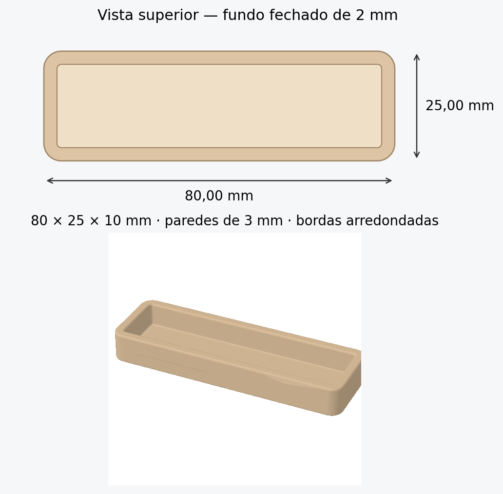

# Bandeja retangular — comprimento de 80,00 mm

- [Baixar STL](https://github.com/MayconDIS/MayconDIS/raw/refs/heads/main/modelos/bandeja-80mm/bandeja_80x25x10mm.stl)
- [Baixar ZIP com STL, prévia e gerador paramétrico](https://github.com/MayconDIS/MayconDIS/raw/refs/heads/main/modelos/bandeja-80mm/bandeja_80mm_arquivos.zip)

Dimensões externas: **80,00 mm de comprimento × 25,00 mm de largura × 10,00 mm de altura**.

Comprimento de 80 mm e fundo fechado de 2 mm conforme solicitado. A largura, a altura e os raios foram estimados pela imagem.

- Fundo: **2,00 mm**.
- Paredes: **3,00 mm** nas faces verticais.
- Profundidade interna: **8,00 mm**.
- Espaço interno nominal: **74,00 × 19,00 mm**, com cantos arredondados.
- Raio externo dos cantos: **4,00 mm**.
- Arredondamento das bordas e da junção interna com o fundo: **0,60 mm**.

Importe no fatiador em **milímetros**. O formato STL não armazena unidades. A base plana está em Z=0.

Validação digital: uma única peça fechada, orientação consistente, volume positivo e dimensões verificadas após exportação. Cortes horizontais confirmam a cavidade e o fundo fechado. Veja [os resultados](validacao.json). A impressão física não foi testada.

Modelo paramétrico aproximado da imagem, com superfícies lisas. A textura da referência não foi reproduzida.
