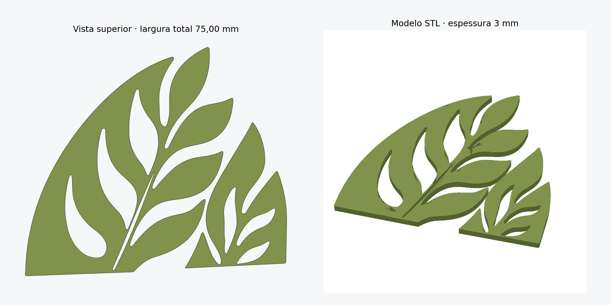

# Folhas — segundo desenho, largura de 75,00 mm

- [Baixar STL completo](https://github.com/MayconDIS/MayconDIS/raw/refs/heads/main/modelos/folhas-75-00mm/folhas_75_00mm_espessura_3mm.stl)
- [Baixar ZIP com as peças individuais](https://github.com/MayconDIS/MayconDIS/raw/refs/heads/main/modelos/folhas-75-00mm/folhas_75_00mm_arquivos.zip)

Dimensões do conjunto: **75,00 mm de largura × 65,64 mm de altura × 3,00 mm de espessura**.

O STL contém duas peças separadas, com base plana e sete recortes internos no total. A medida de 75,00 mm corresponde à largura do conjunto na disposição apresentada. Importe no fatiador em milímetros, pois o formato STL não armazena unidades.

Os contornos foram reconstruídos manualmente a partir da segunda imagem enviada, em perspectiva. O modelo é uma aproximação plana com superfícies lisas; a textura e os arredondamentos da referência não foram reproduzidos.

Validação digital: dois componentes fechados, orientação consistente, volumes positivos e sem sobreposição. Veja [os resultados](validacao.json). A impressão física não foi testada.
