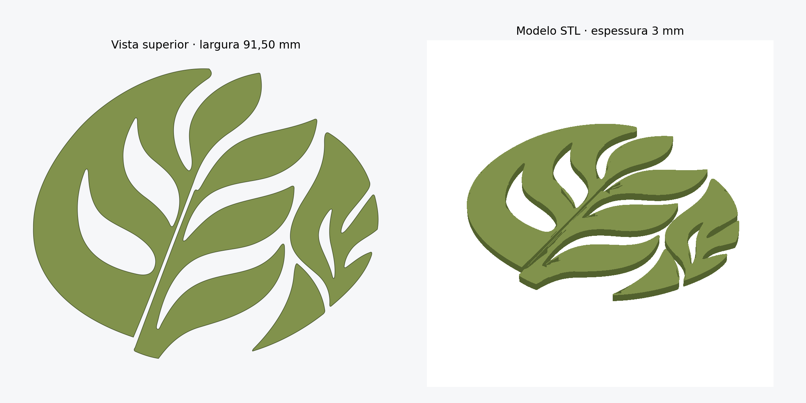

# Folhas — modelo STL de 91,50 mm

- [Baixar STL completo](https://github.com/MayconDIS/MayconDIS/raw/refs/heads/main/modelos/folhas-91-50mm/folhas_91_50mm_espessura_3mm.stl)
- [Baixar ZIP com as peças individuais](https://github.com/MayconDIS/MayconDIS/raw/refs/heads/main/modelos/folhas-91-50mm/folhas_91_50mm_arquivos.zip)

Dimensões do conjunto: **91,50 mm de largura × 76,88 mm de altura × 3,00 mm de espessura**.

O STL contém quatro peças separadas, com base plana e recortes internos. Importe em milímetros no fatiador, pois o formato STL não armazena unidades.

Os contornos foram reconstruídos manualmente a partir de uma imagem em perspectiva. O modelo é uma aproximação com superfícies lisas; a textura e o arredondamento das bordas da referência não foram reproduzidos.

Validação digital: quatro componentes fechados, orientação consistente, volumes positivos e sem sobreposição. Veja [os resultados](validacao.json). A impressão física não foi testada.
